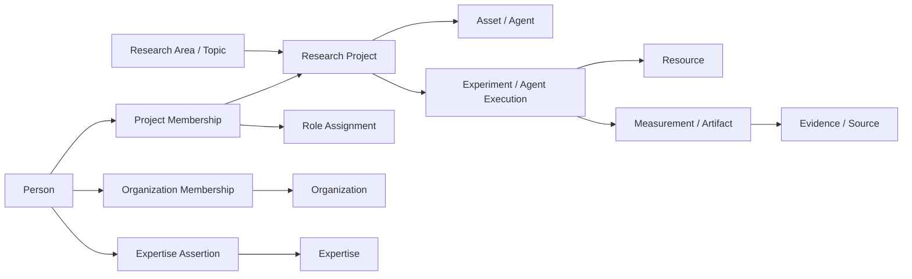

# AI Research Ontology

Memory Solutions의 연구 분류, 조직·사람, 자산·실험·근거를 연결하는 **v0.3 제안 초안**입니다. 기존 v0.2의 5개 Research Area와 161개 세부 Topic을 유지하고 조직과 사람의 이력 모델을 추가했습니다.

연구의 대표 분야는 하나이며, 관련 분야는 추가 참조로 표현합니다. 조직과 사람은 독립된 축이고 ResearchProject가 두 축을 연결합니다.



| 파일 | 역할 |
| --- | --- |
| [ontology/manifest.yaml](ontology/manifest.yaml) | 모델 버전과 데이터 파일 진입점 |
| [ontology/schema.yaml](ontology/schema.yaml) | 32개 객체 유형, 필드, 참조 대상, 기술 관계 정의 |
| [taxonomy/research_taxonomy.yaml](taxonomy/research_taxonomy.yaml) | 5개 Area, 29개 Topic 그룹, 161개 세부 Topic |
| [taxonomy/vocabularies.yaml](taxonomy/vocabularies.yaml) | Workload, Technique, Capability, Metric, Role, Expertise 용어 |
| [examples/graph.yaml](examples/graph.yaml) | 조직 이동·참여·전문성·Agent 사용·실험의 가상 그래프 |
| [docs/modeling-guide.ko.md](docs/modeling-guide.ko.md) | 객체와 관계를 등록하는 기준 |
| [docs/competency-questions.ko.md](docs/competency-questions.ko.md) | 모델이 답해야 할 질문과 실행 예시 |
| [docs/operations.ko.md](docs/operations.ko.md) | 원본 권위, 접근 범위, 운영 책임, 변경 원칙 |
| [docs/pilot-plan.ko.md](docs/pilot-plan.ko.md) | 실제 연구 20~30개로 경계를 검토하는 절차 |
| [templates/research_project.yaml](templates/research_project.yaml) | 실제 연구 등록용 빈 템플릿 |

저장소 루트에서 Python 3.10 이상과 `requirements.txt`의 의존성을 준비한 뒤 실행합니다.

```bash
python3 ai_research_ontology/scripts/validate.py
python3 -m unittest discover -s ai_research_ontology/tests -v
python3 ai_research_ontology/scripts/query.py --query project-people --as-of 2026-10-31
python3 ai_research_ontology/scripts/query.py --query project-people --as-of 2026-11-01
```

예시의 Engineer A는 11월 1일 Interface Team에서 AX Team으로 이동하지만 CXL 프로젝트 참여 ID는 유지됩니다. `asset-users` 조회는 별도의 AssetUsage와 실행 근거를 읽으므로 프로젝트에 참여했다는 이유만으로 사용자를 늘리지 않습니다.

현재 validator는 YAML 중복 키·ID·타입·참조, 기간 충돌, 역할 지정과 전문성의 근거, 실측값 단위·조건, 접근 범위 참조 등을 검사합니다. 실제 HR·GitLab·Confluence·GPU·EDA 시스템 연동과 사용자별 접근 권한 집행은 향후 구현 범위입니다. 1,000명 규모의 실제 데이터 성능은 아직 측정하지 않았습니다.
