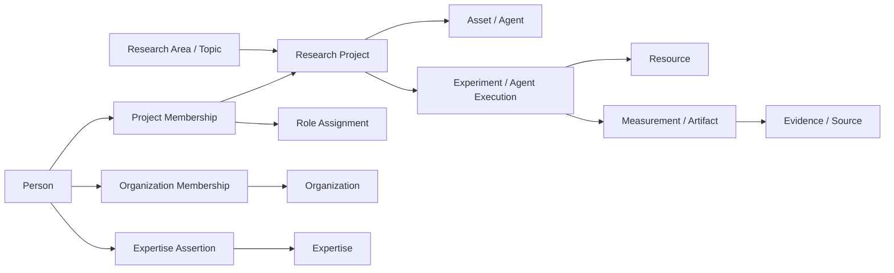

# AI Research Ontology

Memory Solutions의 연구 분류, 조직·사람, 자산·실험·근거와 외부 연구를 연결하는 **v0.4 제안 초안**입니다. 기존 5개 Research Area와 ID를 유지하면서 세부 Topic을 161개에서 **218개**로 확장했습니다. 조직 적용 여부는 아직 제안 단계입니다.

연구의 대표 분야는 하나이며, 관련 분야는 추가 참조로 표현합니다. 조직과 사람은 독립된 축이고 ResearchProject가 두 축을 연결합니다.



| 파일 | 역할 |
| --- | --- |
| [ontology/manifest.yaml](ontology/manifest.yaml) | 모델 버전과 데이터 파일 진입점 |
| [ontology/schema.yaml](ontology/schema.yaml) | 39개 객체 유형, 필드, 참조 대상, 기술 관계 정의 |
| [taxonomy/research_taxonomy.yaml](taxonomy/research_taxonomy.yaml) | 5개 Area, 38개 Topic 그룹, 218개 세부 Topic |
| [taxonomy/vocabularies.yaml](taxonomy/vocabularies.yaml) | Workload, Technique, Capability, Metric, Role, Expertise 용어 |
| [taxonomy/research_facets.yaml](taxonomy/research_facets.yaml) | 데이터 종류 10개, 시스템 계층 13개, 병목 15개, 검증 범위 8개 |
| [research/public_research_registry.yaml](research/public_research_registry.yaml) | 실제 공개 자료 14건과 출처·검토 범위·확인된 내용·한계 |
| [research/research_directions.yaml](research/research_directions.yaml) | 근거를 연결한 10개 연구 방향과 적용 분류 |
| [examples/graph.yaml](examples/graph.yaml) | 조직 이동·참여·전문성·Agent 사용·실험의 가상 그래프 |
| [docs/research-landscape-20261108.ko.md](docs/research-landscape-20261108.ko.md) | 동향을 분류에 반영한 이유, 원문 URL·공개일·조회일과 남은 범위 |
| [docs/modeling-guide.ko.md](docs/modeling-guide.ko.md) | 객체와 관계를 등록하는 기준 |
| [docs/competency-questions.ko.md](docs/competency-questions.ko.md) | 모델이 답해야 할 질문과 실행 예시 |
| [docs/operations.ko.md](docs/operations.ko.md) | 원본 권위, 접근 범위, 운영 책임, 변경 원칙 |
| [docs/pilot-plan.ko.md](docs/pilot-plan.ko.md) | 실제 연구 20~30개로 경계를 검토하는 절차 |
| [templates/research_project.yaml](templates/research_project.yaml) | 실제 연구 등록용 빈 템플릿 |

저장소 루트에서 Python 3.10 이상과 `requirements.txt`의 의존성을 준비한 뒤 실행합니다.

```bash
python3 ai_research_ontology/scripts/validate.py
python3 -m unittest discover -s ai_research_ontology/tests -v
python3 ai_research_ontology/scripts/query.py --query project-people --as-of 2026-10-31
python3 ai_research_ontology/scripts/query.py --query project-people --as-of 2026-11-01
python3 ai_research_ontology/scripts/query.py --query research-landscape --direction vector_search
python3 ai_research_ontology/scripts/query.py --query research-landscape --direction storage_next
```

예시의 Engineer A는 11월 1일 Interface Team에서 AX Team으로 이동하지만 CXL 프로젝트 참여 ID는 유지됩니다. `asset-users` 조회는 별도의 AssetUsage와 실행 근거를 읽으므로 프로젝트에 참여했다는 이유만으로 사용자를 늘리지 않습니다.

추가한 연구 방향은 Vector Search, GPU-Initiated Storage, KV/Context Memory, Training/Checkpoint, Compression, Agent Memory, Computational Storage, HBF/CXL 공동 설계, Data Fabric, Benchmarking입니다. 최신 기술의 이름만 나열하지 않고 **어떤 데이터가 어느 계층에서 어떤 병목을 만나고 무엇으로 평가되는지**를 연결합니다.

Storage-Next는 NVIDIA의 생태계 프로그램인 `TechnologyInitiative`로 등록했습니다. 일반 기술 Topic은 GPU-Initiated Storage이며, SDK·장치 개발·시제품·내부 실험을 구분합니다. Vector Search의 QPS에는 같은 조건의 Recall@k·p99가 필요하고 작은 I/O의 IOPS에는 p99가 필요합니다. 신규 지표 계약도 조직에서 승인하기 전의 제안입니다.

공개 자료는 실제 출처이나 모두 `internal_reproduction_status: not_reproduced`입니다. 논문은 확인한 초록, 업체 기술 글은 해당 글, 표준은 공개 소개 페이지까지의 검토 범위를 보존합니다. 외부 문헌의 Topic·Facet 연결은 이 초안의 분류 판단입니다. 모든 하위 Topic이 각각 최신 논문으로 검증됐다는 의미는 아닙니다.

현재 데이터는 578개 객체이며 validator는 YAML 중복 키·ID·타입·참조, 기간 충돌, 역할 지정과 전문성의 근거, 실측값 단위·조건과 동반 지표, 공개 자료 날짜·검증 상태, 접근 범위 참조 등을 검사합니다. 실제 HR·GitLab·Confluence·GPU·EDA 시스템 연동과 사용자별 접근 권한 집행은 향후 구현 범위입니다. 1,000명 규모의 실제 데이터 성능은 아직 측정하지 않았습니다. 정기 수집 작업은 이 정적 모듈에 포함돼 있지 않습니다.
