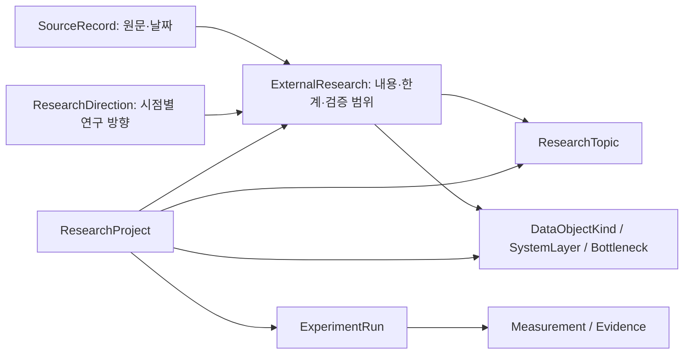

# 공개 연구 동향을 반영한 v0.4 확장

기준일·조회일: **2026-11-08, Asia/Seoul**. 메모리·스토리지와 직접 연결되는 14개 1차 자료를 확인한 표본 조사다. 2026년 자료뿐 아니라 구조를 설명하는 2025년 기반 연구도 포함했다. 공개 논문 초록, 업체 기술 글·발표, 벤치마크 발표, 표준 소개 페이지를 구분해 읽었다. 논문 전체의 재현·제품 검증은 수행하지 않았다.

## 분류에 반영한 판단

5개 Area는 조직의 연구 포트폴리오를 찾는 시작점으로 유지한다. 이를 세계 연구의 유일한 기술 분류로 해석하지 않는다. 아래 방향은 Area 아래에 또 하나의 배타적 계층을 만드는 대신 `ResearchDirection`으로 여러 Area의 Topic과 외부 자료를 연결한다. 이 연결과 연구 질문은 **초안 작성자의 설계 판단**이며 출처 기관의 분류나 조직의 확정 전략이 아니다.

| 연구 방향 | 별도로 다룰 연구 질문 | 연결되는 대표 분야 |
| --- | --- | --- |
| Vector Search & Retrieval Storage | SSD 기반 ANN, Filter/Hybrid 검색, Index Build·Update·Compaction, 검색 품질과 지연 | AI Domain · AI Workload · AI Native Storage |
| GPU-Initiated Storage / Storage-Next | GPU 요청·작은 I/O·Controller·SCADA·제어/데이터 경로 | AI Workload · AI Native Storage |
| KV Cache / Context-memory Tiering | 재사용·배치·Prefetch·분산 Routing과 재계산 비용 | AI Domain · AI Workload · AI Native Storage |
| Training Data / Checkpoint & Recovery | 입력 파이프라인, 비동기 Snapshot, 상태 직렬화, 내구성과 복구 | AI Workload · AI Native Storage |
| Vector / KV Compression | 데이터 의미별 용량·품질·대역폭 Tradeoff | AI Domain · AI Native Storage |
| Persistent Agent Memory | 장기 기억의 검색·갱신·일관성·잊기·근거와 접근 격리 | AI Domain · AI Workload · AI Native Storage |
| Computational Storage / Near-data | 연산을 데이터 가까이 옮길 때의 인터페이스·전력·이동 비용 | AI Native Storage |
| HBF / CXL / Memory–Storage Co-design | 계층별 배치·QoS·가용성·연산과의 공동 설계 | AI Workload · AI Native Storage |
| AI Data Fabric / Object & RDMA | File/Object 접근, 네트워크 전송, 다중 사용자 간섭·무결성 | AI Native Storage · Shared Infra |
| Workload-specific Benchmarking | Training·Checkpoint·Vector·KV를 구분한 비교 계약과 재현성 | AI Workload · Shared Infra |

기존 161개 세부 Topic의 ID를 보존하고 57개를 추가했다. 새 Topic은 위 연구 질문을 수용하기 위한 후보이며, 모든 Topic에 개별 논문을 매칭한 상태는 아니다. 예를 들어 Vector Search는 AI Domain의 검색 품질·시스템 설계, AI Workload의 접근 분석, AI Native Storage의 인덱스·SSD 설계로 나눌 수 있다. 실제 프로젝트의 주된 산출물로 대표 Area를 정한다.

`Storage-Next`는 NVIDIA의 생태계 프로그램으로 `TechnologyInitiative`에 기록한다. 연구 Topic은 업체에 종속되지 않는 GPU-Initiated Storage로 정의한다. GPUDirect 데이터 이동, GPU가 I/O를 요청하는 제어, Storage 장치 내 연산은 각각 다른 기능이다. 프로그램 참여·SDK 공개·제품 계획으로 상호 호환을 확정하지 않는다.

## 확인한 자료와 반영 범위

공개일은 출처가 제시한 날짜다. 아래 자료의 조회일은 모두 **2026-11-08 KST**이며, 세부 상태·원문 위치는 [공개 연구 Registry](../research/public_research_registry.yaml)에 저장했다. 수치 성능 비교는 이번 등록에 넣지 않았다.

| 1차 자료 | 공개일 | 확인한 내용과 검토 범위 | 남은 불확실성 |
| --- | --- | --- | --- |
| [MLPerf Storage v3.0](https://mlcommons.org/2026/09/mlperf-storage-v3-0-results/) | 2026-09-01 | 공식 발표: Training·Checkpoint에 KV·VDB 테스트와 S3 접근 계층 추가 | 개별 제출 결과의 조건·재현 여부는 별도 확인 필요 |
| [NVIDIA cuObject / SCADA](https://developer.nvidia.com/blog/expanding-ai-storage-access-with-nvidia-cuobject-and-the-nvidia-scada-server-sdk/) | 2026-09-30 | 기술 글: Storage-Next, GPU 요청을 처리하는 Server SDK, RDMA 기반 Object 접근 | 라이브러리 제공·업체 시제품·개별 장치의 상호운용 상태가 다름 |
| [KIOXIA GP Series](https://apac.kioxia.com/en-apac/business/news/2026/20260317-1.html) | 2026-03-17 | 공식 발표: 개발 중인 GPU 접근용 Flash SSD와 Emulator | 발표 당시 향후 평가 샘플 계획이며 실제 출하 확인은 아님 |
| [KIOXIA AiSAQ](https://www.kioxia.com/en-jp/business/news/2026/20260317-2.html) | 2026-03-17 | 공식 발표: SSD 기반 검색과 GPU를 이용한 인덱스 생성 | 업체 선택 조건의 결과이며 Online Query와 Build 성능을 분리해야 함 |
| [Microsoft DiskANN / Azure SQL GA](https://devblogs.microsoft.com/azure-sql/diskann-vector-index-search-are-now-generally-available-in-azure-sql/) | 2026-09-29 | 공식 제품 발표: 관계형 Filter·Join과 결합하는 ANN | 제품 제공 범위를 다른 DB·장치의 성능으로 일반화할 수 없음 |
| [NVIDIA cuVS](https://developer.nvidia.com/blog/optimizing-vector-search-for-indexing-and-real-time-retrieval-with-nvidia-cuvs/) | 2025-07-24 | 기술 글: GPU Index Build와 CPU 검색 경로, Filter·Quantization | 알고리즘·Recall·하드웨어 조건에 따른 차이 |
| [Google TurboQuant](https://research.google/blog/turboquant-redefining-ai-efficiency-with-extreme-compression/) | 2026-03-24 | 연구 소개 글: Vector와 KV Cache 압축 | 글의 품질 표현을 모든 모델·Task의 보장으로 확장할 수 없음 |
| [DataStates-LLM](https://arxiv.org/abs/2601.16956) | 2026-01-23 | arXiv 초록: State Provider와 비동기 Checkpoint·Serialization 중첩 | 이 출처만으로 동료 심사·내부 재현을 확인하지 않음 |
| [SNIA Computational Storage v1.2](https://www.snia.org/educational-library/computational-storage-architecture-and-programming-model-v12-2026) | 2026-04-21 | 표준 소개: Computational Storage의 권장 HW/SW 동작 정의 | 상세 조항 전체·구현 적합성·제품 성능은 미검토 |
| [Agentic Memory Management](https://arxiv.org/abs/2610.32464) | 2026-10-23 | arXiv 초록: IR 관점의 기억 관리 연구 의제 | 관점 논문이며 산업 합의나 실증된 시스템 성과가 아님 |
| [NVIDIA Memory Co-design](https://developer.nvidia.com/blog/five-ways-nvidia-co-design-maximizes-the-value-of-every-byte-in-the-ai-factory/) | 2026-11-05 | 기술 글: Weight·KV·CPU·CMX와 실행 구조 공동 설계 | 업체 평가와 내부 실험을 구분해야 함 |
| [SK hynix / Sandisk HBF](https://news.skhynix.com/en/hbf-at-fms-2026/) | 2026-08-04 | 공식 발표: HBF 규격 공개 | 규격 발표는 개별 제품의 양산·호환·성능 확인이 아님 |
| [Mooncake, FAST 2025](https://www.usenix.org/conference/fast25/presentation/qin) | 2025-02, 월 단위 | 학회 초록: KV 중심 Serving, Prefill/Decode 분리와 저자 보고 운영 사례 | 전체 논문 실험·운영 결과를 독립 재현하지 않음 |
| [SK hynix FMS 2026](https://news.skhynix.com/en/fms-2026/) | 2026-08-07 | 공식 기사: 메모리 계층과 CXL·연산 결합 시연, 행사 2026-08-04~06 | 시연과 제공 가능 제품 범위·실제 고객 환경 성능은 구분 필요 |

## 온톨로지 연결과 비교 조건

- `DataObjectKind`: Embedding Vector·ANN Index·KV·Weight·Activation·Training Sample·Checkpoint·Optimizer State·Agent Memory·Metadata를 구분한다. 기존 `subject_kv_cache`와 새 `data_kv_cache`는 `subject_ref`로 연결해 같은 개념의 검색이 끊기지 않게 한다. 실제 데이터 파일·버전은 Artifact로 등록한다.
- `SystemLayer`: GPU/HBM·Host·CXL·HBF·Flash·Shared/Object Storage·Network와 Runtime·Controller의 위치를 표현한다. 대체 가능한 성능 등급이나 단일 직렬 계층을 뜻하지 않는다.
- `Bottleneck`: 용량·대역폭·Random IOPS·Tail Latency·데이터 이동·재계산·Index Build·Freshness·일관성·전력·비용 등 해결하려는 제약을 표현한다.
- `ValidationStage`: 연구 의제·모델·시뮬레이션·시제품·시스템 평가·저자 보고 운영·공식 규격·제품 제공을 구분한다. 순서가 있는 단일 성숙도 점수가 아니다. `review_status`, `availability_at_publication`, `internal_reproduction_status`는 별도 필드다.
- `work_kind`: 과학적 연구·솔루션 엔지니어링·플랫폼 개발·운영을 대표 Area와 독립적으로 기록한다.

QPS는 같은 Run·Benchmark·검색 조건의 Recall@k와 p99를 동반해야 한다. Vector 수·차원·거리 함수·Filter 선택도·Index Version·Query Set·Hardware·Concurrency를 함께 보존한다. 명시한 최소 Recall을 충족하지 못한 결과는 해당 처리량 계약을 만족하지 않는다. Index Build 시간과 Update 가시화 지연은 Online Query 성능과 구분한다.

작은 I/O의 IOPS는 요청 크기·Read/Write·Queue Depth·요청 주체·I/O 경로·Hardware와 p99를 함께 기록한다. Checkpoint는 학습 정지 시간, 내구성 확보 완료 시간, 복구 시간을 분리한다. Agent Memory Utility는 아직 지표 family 후보로 두며 근거 없는 단일 점수를 만들지 않는다. 지표 계약은 조직 승인 전의 초안이다.

## 다음 연구를 반영하는 절차와 남은 범위

1. 원문을 열어 SourceRecord와 ExternalResearch를 등록한다. 공개일의 정밀도·조회일·읽은 범위·주장한 검증 단계와 한계를 보존한다.
2. 기존 Topic·Facet·Metric으로 표현 가능한지 먼저 검토한다. 제품명은 Asset 또는 Initiative로, 기술적 문제는 Topic으로 구분한다.
3. 새 Topic이 필요하면 안정적 ID로 추가하고 관련 ResearchDirection의 근거를 함께 갱신한다. 기존 ID를 재사용해 의미를 바꾸지 않는다.
4. 실제 프로젝트는 명시적 참조로 연결한다. 단어가 겹친다는 이유로 사용 사실·효과·호환을 확정하지 않는다.
5. 내부 재현은 승인된 실제 실행·결과 근거가 있을 때만 별도로 기록한다. 가상 Simulation 결과로 공개 논문의 재현 상태를 바꿀 수 없다.

이번 근거는 NVIDIA·KIOXIA 등 업체 자료 비중이 높다. 중국·유럽의 연구, 최신 FAST/OSDI/SOSP/SIGMOD/VLDB/SC/ISCA/HPCA 논문, EDA·RTL Agent, 기반 모델 학습 알고리즘, 보안·전력·비용의 정량 결과를 전수 검토하지 않았다. 따라서 위 10개 방향은 전체 AI 연구의 완성된 지도나 투자 우선순위가 아니다. 현재 등록된 14개 근거와 후보 Topic을 시작점으로 추가 조사·조직의 실제 프로젝트 검토를 이어가는 구조다. 이 저장소 수정으로 정기 수집 자동화가 설정되지는 않는다.
